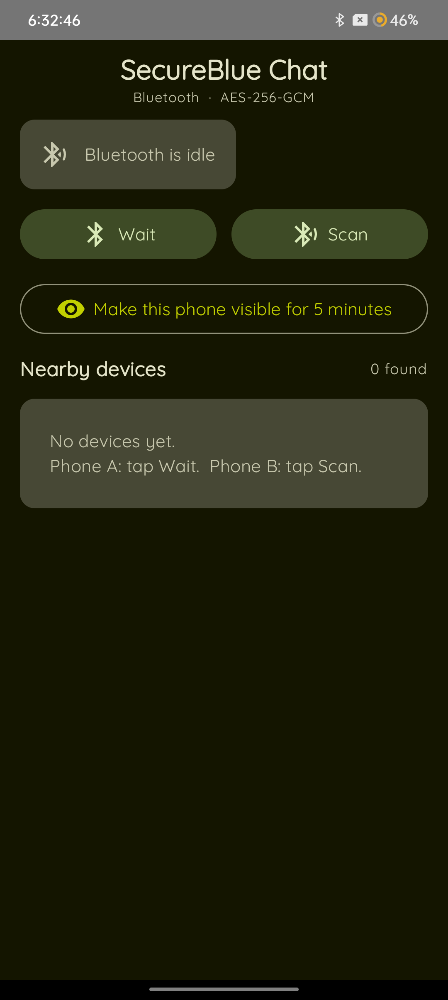

# SecureBlue Chat

Encrypted, serverless messaging between two Android phones over Bluetooth Classic.
No internet, no accounts, no cloud, no server in the middle.

<p align="center">
  
</p>

## What it does

* **Direct link** - the two phones talk to each other over Bluetooth Classic
  (RFCOMM / Serial Port Profile). Nothing is relayed through a server.
* **Shared-PIN session** - both users type the same 4-8 digit PIN. The host sends
  a random 16-byte salt, PBKDF2-HMAC-SHA256 (120,000 iterations) stretches
  PIN + salt into a 256-bit key, and an encrypted challenge-response proves both
  sides derived the same key before any message is shown.
* **AES-256-GCM** - every line on the wire is sealed with a fresh 12-byte IV and
  a 128-bit authentication tag. A wrong PIN fails the tag check.
* **Typing indicator** - carried as a second, equally encrypted message type,
  throttled to one beacon per 1.5 s.
* **Timestamps and quick actions** - time on every bubble, long-press to copy or
  delete a single message, clear the whole chat behind a confirmation.
* **Encrypted history** - conversations survive an app restart, stored per peer
  and sealed with a non-exportable Android Keystore key. The session key is never
  written to disk. Newest 500 messages per peer.

## How it works

```
Phone A (host)                              Phone B (client)
  listenUsingRfcommWithServiceRecord          createRfcommSocketToServiceRecord
        |                                              |
        |---- 16-byte salt (plaintext) --------------->|
        |<--- challenge ciphertext --------------------|
        |---- echo of challenge ---------------------->|
        |                                              |
        |==== AES-256-GCM lines (chat / typing) =======|
```

Each line on the socket is `Base64( IV || AES-256-GCM( type || body ) || tag )`,
newline terminated, so the transport stays a simple stream.

## Install

### From the F-Droid repository

1. Install [F-Droid](https://f-droid.org).
2. *Settings -> Repositories -> +*, then add:

   ```
   https://sakurabun.github.io/securebluechat/repo
   ```

3. Pull to refresh, search for **SecureBlue Chat**, install.

### From a release APK

Download the APK from the releases page and open it on the phone. Android will
ask you to allow installing from that app.

> Both phones must run the same version - the wire format carries a message type
> byte, so an old and a new build will connect but garble messages.

## Build

Requirements: JDK 17 and the Android SDK (compileSdk 34).

```bash
./gradlew assembleDebug     # debug build, installable via adb
./gradlew assembleRelease   # release build, signed if keystore.properties exists
```

`keystore.properties` is optional and never committed:

```properties
storeFile=release-signing/securebluechat-release.jks
storePassword=...
keyAlias=securebluechat
keyPassword=...
```

Without it, `assembleRelease` produces an unsigned APK - which is exactly what
F-Droid's build server expects.

## Permissions

`BLUETOOTH_SCAN`, `BLUETOOTH_CONNECT` and `BLUETOOTH_ADVERTISE` on Android 12+,
`ACCESS_FINE_LOCATION` on older versions. The app requests no network permission
at all.

## Known limits

* No forward secrecy: one key per session, derived from a human-chosen PIN.
* The PIN has to be agreed out of band; there is no QR or safety-number check yet.
* One peer at a time, no group chat, no offline queue.
* The session ends when the app leaves the foreground (no foreground service yet).

## License

Copyright (C) 2026 SecureBlue Chat contributors.

This program is free software: you can redistribute it and/or modify it under the
terms of the GNU General Public License as published by the Free Software
Foundation, either version 3 of the License, or (at your option) any later
version. See [LICENSE](LICENSE).
